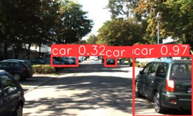
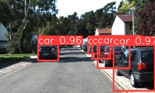
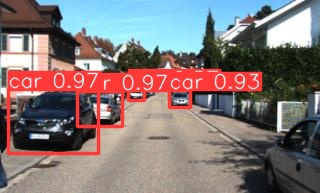
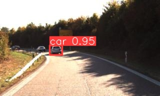
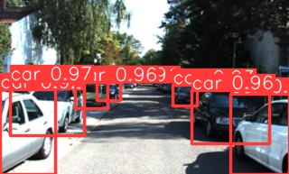
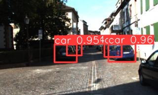
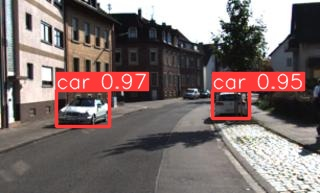
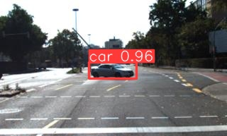
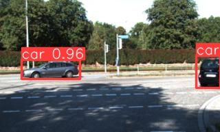

# Perception-of-Autonomous-Vehicles-Preview

*2D Object detector based on camera data*

In this project, a vehicle object detection network is trained leveraging YOLOv5 and YOLOv8 models. Performance of such models is assessed based on precision, recall, and Mean Average Precision (mAP).

Two different datasets derived from the KITTI datase, including an augmented dataset, were used to train and evaluate the models. Results showed that YOLOv8 trained on the augmented dataset achieved the highest mAP score. The study also identified challenges in detecting vehicles near image edges. Future work may involve addressing this limitation and further improving the models’ performance.

The evaluation results demonstrated that the YOLOv8 model trained on the augmented dataset achieved the high-est mAP50 score of 0.983, highlighting its superior performance compared to the other models. The use of augmented data proved beneficial in enhancing the detection capabilities of the YOLOv8 model. However, all models exhibited acceptable performance, with mAP50 values greater than or equal to 0.95, indicating their effectiveness in vehicle object detection.

*Evaluation of the validation dataset*

|Model|Dataset|Precision|Recall|mAP50|
|-----|-------|---------|------|-----|
|YOLOv5 Original|Original|0.964|0.932|0.974|
|YOLOv5 Original|Augmented|0.919|0.911|0.950|
|YOLOv5 Augmented|Original|0.981|0.941|0.973|
|YOLOv5 Augmented|Augmented|0.976|0.939|0.976|
|YOLOv8 Original|Original|0.974|0.943|0.979|
|YOLOv8 Original|Augmented|0.910|0.892|0.951|
|YOLOv8 Augmented|Original|0.976|0.958|0.981|
|YOLOv8 Aug,emted|Augmented|0.980|0.953|0.983|

*Predictions on the test dataset*

|Model|Average confidence score|
|-|-|
|YOLO v5 Original|0.8776|
|YOLO v5 Augmented|0.8785|
|YOLO v8 Original|0.8671|
|YOLO v8 Augmented|0.8715|

*Prediction results with bounding boxes*

* Augmented images filpped dataset:

* Augmented images cropped dataset:

* Augmented images gray-scale dataset:

* Augmented images saturated dataset:

* Augmented images brightened dataset:

* Augmented images darkened dataset:

